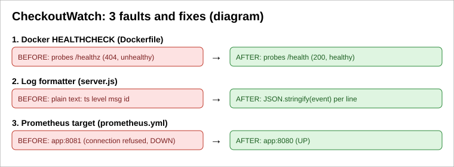
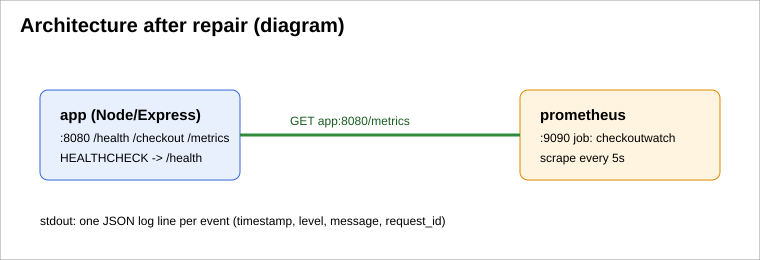
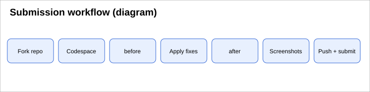

# CheckoutWatch Observability Repair

DevOps  starter. Exactly three faults affect container health monitoring, log formatting, and Prometheus collection. Repair the existing scaffold; do not implement a new application. Everything runs locally at ₹0 / $0.

## Setup

Install Git, Docker with Compose v2, curl, and jq. Start your Docker engine and check:

```bash
git --version
docker info
docker compose version
curl --version
jq --version
```

Fork https://github.com/kalviumcommunity/checkoutwatch-observability-repair on GitHub, then clone your own public fork:

```bash
git clone https://github.com/<your-username>/checkoutwatch-observability-repair.git
cd checkoutwatch-observability-repair
git checkout -b fix/ca5-observability
docker compose up -d --build
docker compose ps
```

Allow up to 45 seconds for health checks and initial scrapes. Expected original symptoms: the app is **unhealthy**, logs are plain text, and the Prometheus app target is **DOWN**. The app process and monitoring UI still start.

Image downloads require internet. Host ports 8080 and 9090 must be available. Stop only your own conflicting services only if safe to do so. Missing tools, blocked downloads, and fork restrictions are infrastructure issues, not planted faults. No cloud workaround is required.

## Expected contract

- App service `app` listens on container port **8080**.
- `GET /health` returns HTTP 200 and `{"status":"ok"}`. Container probe must reflect this endpoint. This is shallow process liveness, not dependency readiness.
- `GET /checkout` returns HTTP 200.
- `GET /checkout?fail=1` intentionally returns HTTP 500 to generate a traceable failure. Keep this fixture; it is not a fourth bug.
- Each checkout response includes `X-Request-ID`. Start and completion/failure events carry that same UUID.
- Every app event must be one JSON object per line containing `timestamp`, `level`, and `message`. Checkout events also require `request_id`.
- Normal events use `info`. Controlled failure uses `error`. Startup is informational, not a simulated error.
- `/metrics` exposes standard Prometheus text including **`checkout_requests_total`**. It increments once per checkout request, including test failures, but not for health checks or metric scrapes.
- Prometheus collects the app's `/metrics` under job **`checkoutwatch`** using service DNS on the Compose network.
- Prometheus is available at http://localhost:9090/targets and http://localhost:9090/query. Use Table view for instant query results.

A healthy process can return an intentional test error. Docker health status alone does not automatically restart an unhealthy container; restart automation is outside this exercise.

## Investigate and verify

Capture original evidence **before** rebuilding: old container logs may disappear. Inspect the health endpoint, probe state, raw logs, and Targets page:

```bash
curl -i http://localhost:8080/health
docker compose ps
docker inspect --format '{{json .State.Health}}' "$(docker compose ps -q app)"
curl -i http://localhost:8080/checkout
curl -i 'http://localhost:8080/checkout?fail=1'
docker compose logs --no-log-prefix --no-color app
curl -sS http://localhost:8080/metrics
```

Compare runtime observations and configuration with the contract. After source or Dockerfile edits:

```bash
docker compose up -d --build
```

After Prometheus configuration edits:

```bash
docker compose restart prometheus
```

Scrapes run every 5 seconds. Allow two intervals before checking a changed signal. Container health probes also run every 5 seconds.

After logging repairs, generate fresh success/failure requests and inspect them:

```bash
docker compose logs --no-log-prefix --no-color app | jq -c .
docker compose logs --no-log-prefix --no-color app | jq -c 'select(.level == "error")'
docker compose logs --no-log-prefix --no-color app \
  | jq -c --arg id '<actual-failing-request-id>' 'select(.request_id == $id)'
```

Replace the placeholder with the failing response's actual `X-Request-ID`. Never hard-code a sample log line or hide errors. Do not log secrets or sensitive information.

For monitoring proof, evaluate `checkout_requests_total` in Prometheus Table view, generate five requests below, wait two scrape intervals, then evaluate again:

```bash
for i in 1 2 3 4 5; do
  curl -sS http://localhost:8080/checkout
  printf '\n'
done
```

With no other checkout traffic or intervening app restart, the counter increases by five. It resets when the app restarts; do not rebuild midway through this comparison.

## Scope and cleanup

Repair the existing container probe, shared log formatter, and Prometheus scrape configuration. Preserve checkout business logic, controlled failure, request correlation, metric semantics and ports. Compare original and repaired observations; do not replace live signals with constants or disable checks. No Grafana, alert-rule implementation, cloud deployment or real credentials needed.

```bash
docker compose down
```

Remove only your exercise resources.

---

# Repair Report and Submission Guide

## 1. The three faults and the fixes

| # | Area | Symptom (original) | Root cause | Fix |
|---|------|--------------------|-----------|-----|
| 1 | Container health | `docker compose ps` shows `app` **unhealthy** | `HEALTHCHECK` in `Dockerfile` probed `/healthz`, which does not exist (404). The app serves `/health`. | `Dockerfile`: probe `http://localhost:8080/health` |
| 2 | Log formatting | Logs are plain text: `<ts> info checkout.started <id>` | The shared `log()` in `server.js` wrote a space-separated string instead of JSON | `server.js`: `process.stdout.write(JSON.stringify(event) + '\n')` |
| 3 | Prometheus collection | Target `checkoutwatch` is **DOWN** (connection refused) | `prometheus.yml` scraped `app:8081`, but the app listens on `8080` | `prometheus.yml`: target `app:8080` |

The fixes do not touch checkout logic, `?fail=1`, `X-Request-ID`, the metric semantics, or the ports.
The `log()` fix is in the shared formatter, so startup and checkout events all become JSON (with `timestamp`, `level`, `message`, and `request_id` on checkout events).

```diff
- HEALTHCHECK ... get('http://localhost:8080/healthz', ...
+ HEALTHCHECK ... get('http://localhost:8080/health', ...

- process.stdout.write(`${event.timestamp} ${event.level} ${event.message} ${event.request_id || '-'}\n`);
+ process.stdout.write(`${JSON.stringify(event)}\n`);

-      - targets: ['app:8081']
+      - targets: ['app:8080']
```

## 2. Expected results after the fix

| Check | Before | After |
|-------|--------|-------|
| `docker compose ps` | `app` unhealthy | `app` healthy |
| Health probe log | `probe HTTP 404` | `probe HTTP 200` |
| `docker compose logs app` | plain text lines | one JSON object per line; `jq` parses all lines |
| `?fail=1` | 500, but log not JSON | 500, `level":"error"`, same `request_id` as the `X-Request-ID` header |
| Prometheus `/targets` | `checkoutwatch` **DOWN** (`app:8081`, connection refused) | `checkoutwatch` **UP** (`app:8080/metrics`) |
| `checkout_requests_total` | not collected | increases by exactly 5 after 5 checkout requests |

## 3. Important note on evidence

This repo's fixes were made by reading the code against the contract. The "Before/After" table above is the **expected** outcome. Your submission must contain **your own real output**, so run the steps below on a machine with Docker. Do not paste invented output or edited screenshots.
No Docker on your laptop? Use **GitHub Codespaces** (free tier): open your fork, press **Code, Codespaces, Create codespace on main**. Docker and Compose are preinstalled. Forward ports 8080 and 9090 to view Prometheus in the browser.

## 4. How to submit, step by step

1. **Fork** https://github.com/kalviumcommunity/checkoutwatch-observability-repair to your GitHub account (public).
2. Get this code into your fork, either by cloning your fork and copying in the changed files (`Dockerfile`, `server.js`, `prometheus.yml`, `README.md`, `capture-evidence.sh`), or by pushing this folder:
   ```bash
   git remote add myfork https://github.com/<your-username>/checkoutwatch-observability-repair.git
   git checkout -b fix/ca5-observability
   git push -u myfork fix/ca5-observability
   ```
3. Open a Codespace (or any Docker machine) on that branch.
4. **Capture BEFORE evidence** on the original code. Do this first, since old logs disappear:
   ```bash
   git stash -u            # or: git checkout main -- Dockerfile server.js prometheus.yml
   chmod +x capture-evidence.sh && ./capture-evidence.sh before
   ```
   Screenshot http://localhost:9090/targets (shows **DOWN**).
5. **Apply the fixes** (`git stash pop` or `git checkout fix/ca5-observability -- Dockerfile server.js prometheus.yml`), then:
   ```bash
   docker compose down
   ./capture-evidence.sh after
   ```
   This rebuilds, waits 45 s, saves health state, logs, JSON checks, request-ID trace, and the counter before/after (+5). Do not rebuild during the counter comparison.
6. Screenshot http://localhost:9090/targets (shows **UP**), and http://localhost:9090/query with `checkout_requests_total` in **Table** view.
7. Commit the code and the evidence, then push:
   ```bash
   git add -A && git add -f evidence
   git commit -m "fix: repair health probe, JSON logging, and Prometheus scrape target"
   git push
   ```
   (`evidence/` is in `.dockerignore`, so it never enters the image. It may be git-ignored, hence `-f`.)
8. Clean up: `docker compose down`.
9. **Submit** the URL of your public fork/branch (and open a PR if your instructor asks). Include the screenshots or the `evidence/` folder.

## 5. Submission checklist

- [ ] Public fork URL, branch `fix/ca5-observability`
- [ ] Diff touches only `Dockerfile`, `server.js`, `prometheus.yml` (plus docs/script)
- [ ] `evidence/before/*` and `evidence/after/*` (real output)
- [ ] Screenshot: Targets DOWN (before) and UP (after)
- [ ] Screenshot: `checkout_requests_total` before and after +5
- [ ] `docker compose ps` shows `app` healthy
- [ ] Failing request's `X-Request-ID` traced through `jq` (start + failed events)

## 6. Short write-up (paste into your submission)

> I found three independent faults. (1) The Docker HEALTHCHECK probed `/healthz`, which returns 404, so the container stayed unhealthy; I pointed it at the real `/health` endpoint. (2) The shared `log()` function emitted space-separated text; I changed it to `JSON.stringify(event)` so every event is one JSON object with `timestamp`, `level`, `message` and, for checkout events, `request_id`. (3) Prometheus scraped `app:8081` while the app listens on `8080`, so the target was DOWN; I corrected it to `app:8080`. I verified each with before/after evidence (container health state, `jq`-parsed logs, request-ID trace of a failing request, Prometheus Targets page, and `checkout_requests_total` rising by 5).

---

# Diagrams





*These are explanatory diagrams, not screenshots. Real screenshots of your own run go in `evidence/screenshots/` (see Section 8).*

# Copy-paste quick run (GitHub Codespaces or any Docker machine)

**Step A: before evidence (original code)**
```bash
git checkout main
chmod +x capture-evidence.sh
./capture-evidence.sh before
```

**Step B: after evidence (fixed code)**
```bash
docker compose down
git checkout fix/ca5-observability
./capture-evidence.sh after
```

**Step C: manual checks**
```bash
docker compose ps
curl -i http://localhost:8080/health
curl -i 'http://localhost:8080/checkout?fail=1'
docker compose logs --no-log-prefix --no-color app | jq -c .
```

**Step D: commit, push, clean up**
```bash
git add -A && git add -f evidence
git commit -m "fix: repair health probe, JSON logging, and Prometheus scrape target"
git push -u origin fix/ca5-observability
docker compose down
```

# 8. Screenshots to take (save in `evidence/screenshots/`)

| File name | What to capture |
|-----------|-----------------|
| `before-targets.png` | http://localhost:9090/targets with `checkoutwatch` DOWN |
| `before-ps.png` | `docker compose ps` showing unhealthy |
| `after-targets.png` | Targets page with `checkoutwatch` UP |
| `after-ps.png` | `docker compose ps` showing healthy |
| `after-logs.png` | `docker compose logs ... \| jq -c .` output |
| `after-counter.png` | `checkout_requests_total` Table view before and after +5 |

# 9. Results table (fill in from your `evidence/` files)

| Check | Your real value |
|-------|-----------------|
| Health before / after | `evidence/before/02-health-state.json` / `evidence/after/02-health-state.json` |
| Target before / after | `evidence/before/06-prom-targets.json` / `evidence/after/06-prom-targets.json` |
| Failing request ID | `evidence/after/09-failing-request-id.txt` |
| Counter before / after | `evidence/after/11-counter-before.txt` / `evidence/after/13-counter-after.txt` |
